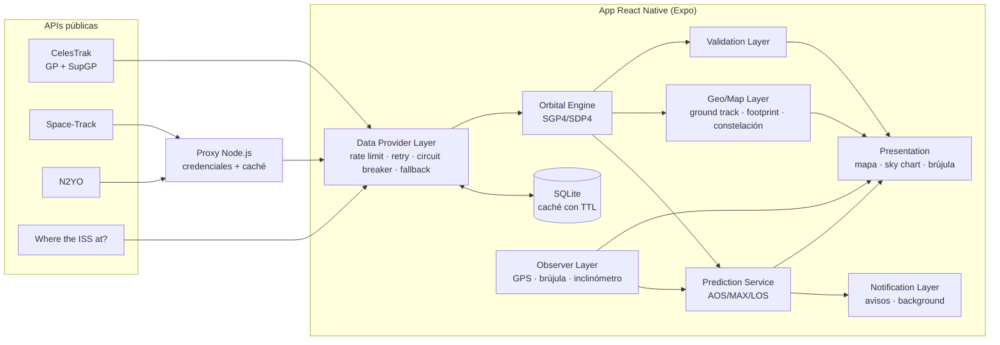

# Documento técnico — Satellite Tracker

**TP N° 7 · Programación Móviles 2026 · Licenciatura en Sistemas de Información · FCyT-UADER**

Este documento explica el modelo de propagación orbital, los algoritmos implementados, la arquitectura y los supuestos y limitaciones de la aplicación.

---

## 1. Visión general

La app calcula **localmente**, en el teléfono, la posición de cualquier satélite del catálogo público a partir de sus elementos orbitales (OMM/TLE). La red sólo se usa para:

1. descargar elementos orbitales (como mucho cada 12–24 h, con caché), y
2. validar las posiciones contra fuentes independientes (a pedido).

Nunca se consulta una API por cada frame de la UI. El marcador del mapa se mueve con posiciones SGP4 recalculadas cada 500 ms, sin interpolar.



## 2. Modelo de propagación orbital

### 2.1 SGP4/SDP4

Los elementos orbitales públicos (TLE/OMM "GP") **no** son elementos keplerianos osculantes: son *elementos medios* ajustados por el 18th Space Defense Squadron para que, evaluados con el modelo **SGP4** (*Simplified General Perturbations 4*), reproduzcan las observaciones de radar. Por eso hay que usar SGP4 para propagarlos, y no la ecuación de Kepler. Con otro modelo el error es de cientos de km.

SGP4 modela:

- el achatamiento terrestre (armónicos zonales J2, J3, J4);
- el arrastre atmosférico, mediante el término balístico **B\*** y una atmósfera de densidad exponencial;
- para órbitas con período ≥ 225 min (MEO, GEO, HEO), la variante **SDP4** agrega perturbaciones lunisolares y resonancias geopotenciales de 12 h y 24 h.

Usamos [`satellite.js`](https://github.com/shashwatak/satellite-js) 7.1, un port a JavaScript de la implementación de referencia de Vallado *et al.* (*Revisiting Spacetrack Report #3*, AIAA 2006-6753). La librería elige SGP4 o SDP4 automáticamente según el movimiento medio. El wrapper tipado está en [`app/src/core/orbital/engine.ts`](../app/src/core/orbital/engine.ts).

### 2.2 Formato de entrada: OMM/JSON como formato principal

El formato TLE tiene un campo de **5 dígitos** para el número de catálogo. Desde 2026 el catálogo superó el 99 999 (en los datos de Starlink que descargamos hay **580 objetos con NORAD de 6 dígitos**, por ejemplo `STARLINK-38128 = 100001`). Esos objetos **no tienen representación TLE**. Por eso:

- todos los proveedores que lo permiten se consultan en **OMM/JSON** (CCSDS Orbit Mean-Elements Message), y la app los procesa con `json2satrec`;
- el TLE se acepta sólo como respaldo (N2YO, Where the ISS at?), con `twoline2satrec`;
- un test automático verifica que un objeto de 6 dígitos se propaga correctamente.

El OMM tiene además **más precisión numérica**: por ejemplo, el B\* de la ISS es `0.0001274916` en OMM y `12749-3` (= 0.00012749) en TLE. En el informe de validación se mide el efecto de esta diferencia.

### 2.3 Cadena de transformaciones de coordenadas

| Paso | De → a | Detalle |
|---|---|---|
| 1 | elementos → r, v | `propagate(satrec, t)`: posición/velocidad en **TEME** (*True Equator, Mean Equinox*), km y km/s |
| 2 | TEME → ECEF | rotación por el **GMST** (tiempo sidéreo medio de Greenwich, `gstime`) |
| 3 | ECEF → geodésicas | elipsoide **WGS-84** → latitud, longitud y altura del **punto subsatelital** |
| 4 | ECEF − ECEF_obs → SEZ | vector observador→satélite rotado al sistema topocéntrico Sur-Este-Cenit |
| 5 | SEZ → az/el/rango | `az = atan2(−E, S) + π` (desde el Norte, sentido horario), `el = asin(Z/ρ)` |

### 2.4 Parámetros derivados

Del movimiento medio *n* se obtienen el período `T = 2π/n`, el semieje mayor por la 3ª ley de Kepler `a = ∛(μ/n²)` y las alturas de perigeo y apogeo `a(1∓e) − R⊕`. Con ellos se clasifica la órbita:

| Clase | Criterio |
|---|---|
| HEO | e > 0,25 (Molniya, GTO) |
| LEO | apogeo < 2000 km |
| GEO | 1380 min < T < 1500 min (≈ día sidéreo) |
| MEO | el resto (p. ej. GPS, T ≈ 718 min) |

## 3. Algoritmos

### 3.1 Predicción de ventanas de visibilidad (RF-04) — [`passes.ts`](../app/src/core/prediction/passes.ts)

**El problema.** Evaluar la elevación cada 1 s durante 72 h significa 259 200 propagaciones por satélite. Con un paso grueso fijo (por ejemplo 60 s) se pierden pases cortos o rasantes, y no se sabe cuál es un paso "seguro".

**Solución: paso adaptativo con cota física + refinamiento.**

1. **Cota de la velocidad angular de elevación.** La elevación de un objeto cambia como máximo a razón de `v_rel / ρ`, donde ρ es la distancia al observador. Acotamos:
   - `v_rel ≤ v_perigeo + v_rotación_terrestre` (vis-viva: `v² = μ(2/r − 1/a)`; rotación ≤ 0,465 km/s);
   - con el satélite **sobre** el horizonte, `ρ ≥ h_perigeo` (pase cenital, el peor caso) → cota ≈ 1,3 °/s para la ISS;
   - con el satélite **bajo** el horizonte, `ρ ≥ √((R+h)² − R²)` (distancia al horizonte) → cota ≈ 0,25 °/s para la ISS.

   Se aplica un factor de seguridad de 1,25. Un test recorre 6 h segundo a segundo y verifica que la elevación real nunca supera la cota.

2. **Fase gruesa.** Si la elevación actual es `el` y el umbral es `ε`, el satélite no puede cruzarlo antes de `t_min = |ε − el| / ė_max`, separando el tramo bajo y sobre el horizonte. Avanzamos exactamente ese tiempo, acotado a [5 s, T/16]. Lejos del horizonte los pasos son de varios minutos; cerca, de pocos segundos. **Como nunca se avanza más que el tiempo mínimo para cruzar el umbral, no se pueden saltear pases** (salvo los de menos de 5 s por encima del umbral, irrelevantes en la práctica).

3. **Refinamiento de AOS/LOS.** Ante un cambio de signo de `el − ε` entre dos muestras, una **bisección** encuentra el instante de cruce con precisión de 1 s (~log₂(paso) iteraciones).

4. **Máximo.** Entre AOS y LOS la elevación de un pase es unimodal: una **búsqueda de sección dorada** encuentra el instante y la elevación máxima con precisión de 1 s.

5. **Casos borde.**
   - Si la búsqueda arranca **en medio de un pase**, se busca hacia atrás (hasta una órbita) el AOS real.
   - **GEO** siempre visible: un único pase "continuo", marcado como recortado en ambos extremos.
   - **GEO** bajo el horizonte: ningún pase, con ~280 evaluaciones para 72 h.
   - Si SGP4 falla (objeto decaído), la muestra se trata como "bajo el horizonte".

**Resultados medidos** ([`resultados-benchmark.md`](resultados-benchmark.md), 72 h, ε = 10°):

| Satélite | Clase | Reducción de propagaciones | Exactitud AOS/LOS vs. fuerza bruta (1 s) |
|---|---|---:|---:|
| ISS | LEO | ×53 | ≤ 1,2 s |
| NOAA 19 | LEO polar | ×69 | ≤ 1,2 s |
| Starlink (NORAD 100001) | LEO | ×69 | ≤ 1,0 s |
| GPS | MEO | ×228 | ≤ 1,1 s |
| Molniya | HEO | ×64 | ≤ 0,9 s |
| GOES 16 | GEO | ×913 | exacto |

Los tests automáticos (`passes.test.ts`) comparan el algoritmo con la búsqueda ingenua a paso de 1 s para 4 configuraciones y exigen **los mismos pases**, AOS/LOS a ±2 s, elevación máxima a ±0,05° y al menos 20 veces menos propagaciones.

**No bloquear la UI.** `findPassesAsync` cede el hilo de JS al event loop entre pase y pase. Como cada pase cuesta ~300 propagaciones (≈ 1–2 ms en Hermes), la UI nunca se congela. No hizo falta un Web Worker ni un módulo JSI: la mejora algorítmica (×50–×900) resolvió el problema de costo que plantea el enunciado.

### 3.2 Visibilidad óptica vs. pase de radio

Un pase es **visible a simple vista** si en algún momento, con el satélite sobre el umbral:

- el satélite está **iluminado** por el Sol (modelo de sombra cónica umbra/penumbra de satellite.js, `shadowFraction < 0,5`), y
- el observador está en **oscuridad**: Sol a menos de −6° (crepúsculo civil).

Los demás pases siguen siendo válidos para un **enlace de radio**. El sky chart colorea cada tramo de la trayectoria según la iluminación.

### 3.3 Ground track y antimeridiano (RF-11) — [`groundTrack.ts`](../app/src/core/orbital/groundTrack.ts)

- **Muestreo:** paso automático de ~150 muestras por órbita, acotado a [30 s, 600 s]. Para LEO (T ≈ 93 min) da **37 s**, dentro del rango de 30–60 s que pide el enunciado. Se dibuja media órbita pasada (gris, punteada) y 1,05 órbitas futuras (cian).
- **Antimeridiano:** cuando entre dos muestras consecutivas la longitud salta más de 180°, se **corta** la polilínea. Además se **interpola la latitud exacta del cruce**: se desenrolla la longitud de la segunda muestra (±360°) y se interpola linealmente en `lon = ±180°`. El segmento termina justo en el borde del mapa y el siguiente arranca en el borde opuesto, sin líneas que crucen el mapa ni huecos.

### 3.4 Footprint (RF-12) — [`footprint.ts`](../app/src/core/orbital/footprint.ts)

En el triángulo Centro de la Tierra–Observador–Satélite, con elevación mínima ε:

```
sin η = R·cos ε / (R + h)          (ángulo nadir, ley de senos)
λ = 90° − ε − η                     (ángulo central)
radio sobre la superficie = R·λ
rango oblicuo máximo = √((R+h)² − (R cos ε)²) − R sin ε
área = 2πR²(1 − cos λ)
```

**Verificación:** para la ISS (h = 424 km, ε = 0°) obtenemos un diámetro de 4528 km, el mismo valor que publica Where the ISS at? en su campo `footprint`. Para GEO con ε = 0° da λ = 81,3° (≈ 42 % de la Tierra). Ambos casos son tests automáticos.

El borde es un círculo menor de radio λ (120 vértices calculados con la fórmula del punto destino sobre la esfera). Para dibujarlo en Mercator se resuelven dos casos:

- **Cruza el antimeridiano:** se desenrollan las longitudes alrededor del centro y se recorta con **Sutherland–Hodgman** contra `lon = ±180°`, generando dos polígonos válidos.
- **Contiene un polo** (GEO/MEO, o LEO a latitudes altas con ε bajo): el "círculo" se vuelve una banda que rodea el polo. Se ordenan los vértices por longitud (cada meridiano corta el borde una sola vez), se cierra contra el borde del mapa (±85°) y se trocea en **4 franjas de 90°**, para que ningún lado del polígono abarque 180° o más (lo que haría ambiguo su dibujo).

### 3.5 Capa de constelación (RF-13) — [`constellation.ts`](../app/src/core/orbital/constellation.ts)

- **Submuestreo uniforme:** con un límite N configurable (300 por defecto), se toma 1 de cada ⌈total/N⌉ satélites para cubrir todos los planos orbitales, en lugar de los primeros N (que serían los de un mismo lanzamiento).
- **Propagación en lote por bloques de 150**, cediendo el hilo entre bloques. Se refresca cada 3 s y nunca se lanzan dos lotes en paralelo (*throttling*). Medido: 300 satélites en 3,4 ms; los **11 206** satélites de Starlink en 55 ms (V8).
- **Agrupamiento por grilla dependiente del zoom:** celdas de `Δlon_visible / 9` grados. El costo es O(n) y las claves de celda son estables entre refrescos, así que el mapa dibuja como mucho unas decenas de marcadores aunque haya miles de satélites. Sólo se agrupan los puntos del viewport (más un margen). Un cluster muestra la cantidad y uno individual, el nombre.

### 3.6 Parámetros de enlace (contexto de telecomunicaciones)

En el detalle de cada pase se calculan, para AOS, MÁX y LOS y para 4 bandas (VHF 145,8 · UHF 437 · L 1575 · Ku 12 000 MHz):

- **Pérdida de espacio libre:** `FSPL(dB) = 20 log d_km + 20 log f_MHz + 32,44`. Para la ISS varía hasta ~15 dB entre el horizonte (ρ ≈ 2300 km) y el cenit (ρ ≈ 420 km), y por eso los enlaces LEO definen una elevación mínima de operación (ITU-R).
- **Doppler:** `Δf = −f·ṙ/c`, con la velocidad radial ṙ obtenida por diferencia central de ±0,5 s. Cambia de signo en el máximo acercamiento (hasta ±3,2 kHz en VHF para la ISS).

### 3.7 Modo brújula (RF-07)

- **Rumbo:** `Location.watchHeadingAsync().trueHeading`, referido al Norte **geográfico**, igual que el azimut de SGP4. Se suaviza con un filtro paso-bajo circular, que evita el salto 359° → 0°.
- **Inclinación:** `DeviceMotion.rotation.beta` (0° con el teléfono plano, 90° vertical) se interpreta como la elevación hacia la que apunta el borde superior.
- **Objetivo:** la posición actual si el satélite está sobre el horizonte; si no, el punto de AOS del próximo pase ("esperalo acá").
- El sky chart se dibuja rotado según el rumbo, como un dial. Hay instrucciones textuales ("Girá 35° a la derecha", "Levantá el teléfono 20°") y una vibración háptica al quedar alineado (±8°).

## 4. Arquitectura y decisiones de implementación

| Capa | Archivos | Notas |
|---|---|---|
| Data Provider Layer | `src/core/data/**` | Interfaz `DataProvider` (getCatalog, getOrbitalData, getValidationPosition, searchByName), 4 implementaciones, `OrbitalRepository` (orquestador), `RateLimiter`, `withRetry`, `CircuitBreaker`. Ver [03-decisiones-fuentes-datos.md](03-decisiones-fuentes-datos.md) |
| Persistencia | `src/services/sqliteStore.ts`, `kv.ts` | SQLite (tablas `orbital`, `group_member`, `group_meta`) e inserciones multi-fila en una transacción. AsyncStorage se descartó por su límite de ~6 MB en Android (Starlink ≈ 5 MB) |
| Orbital Engine | `src/core/orbital/engine.ts`, `sun.ts` | Wrapper tipado de satellite.js: grados/km/ms en toda la API pública y radianes sólo adentro |
| Prediction Service | `src/core/prediction/passes.ts`, `link.ts` | Algoritmo adaptativo, versión asíncrona y fuerza bruta de referencia |
| Geo/Map Layer | `src/core/orbital/{groundTrack,footprint,constellation}.ts`, `src/app/(tabs)/index.tsx` | `react-native-maps`: Marker, Polyline, Polygon |
| Observer Layer | `src/services/bootstrap.ts`, `src/app/(tabs)/compass.tsx` | `expo-location` (GPS + rumbo), `expo-sensors` (DeviceMotion) |
| Validation Layer | `src/core/validation/compare.ts`, `src/app/validation.tsx`, `scripts/validate.ts` | Error horizontal (haversine), de altitud, 3D (ECEF) y de apuntamiento |
| Presentation | `src/app/**`, `src/components/**` | Expo Router con 5 pestañas y 3 pantallas apiladas; sky chart con `react-native-svg` |
| Notification Layer | `src/services/notifications.ts`, `background.ts` | `expo-notifications` (trigger DATE), `expo-background-task` y `expo-task-manager` |

**Separación núcleo/plataforma.** Todo `src/core/` es TypeScript puro, sin dependencias de React Native. Por eso lo ejecutan los tests (vitest, en Node), los scripts de validación y benchmark, y la tarea en background, con **el mismo código** que la UI.

**Elección de Expo en lugar de las librerías sugeridas.** El enunciado propone `react-native-geolocation-service`, `react-native-sensors`, `notifee` y `react-native-background-fetch`. Usamos sus equivalentes del SDK de Expo (`expo-location`, `expo-sensors`, `expo-notifications`, `expo-background-task`), que están incluidos en **Expo Go**. Así el proyecto corre "vía Metro" en un teléfono físico sin compilar código nativo, que es una de las formas de entrega que admite el TP. `react-native-maps` y `react-native-svg` se usan tal como sugiere el enunciado.

**Runtime WASM de satellite.js.** La versión 7 incluye un propagador en lote opcional compilado a WebAssembly, que Hermes no soporta. Como sólo usamos la API JavaScript, `metro.config.js` redirige esos imports internos a un stub ([`shims/satellite-wasm-stub.js`](../app/shims/satellite-wasm-stub.js)).

**Notificaciones idempotentes.** El identificador de cada aviso es `pass-<NORAD>-<minuto del AOS>`. Reprogramar el mismo pase reemplaza la notificación en vez de duplicarla, así que la tarea en background puede recalcular y reprogramar sin efectos secundarios.

**Tarea en background (RF-09).** El sistema la ejecuta cada ≥ 60 min (sin garantía de horario; en iOS suele ser de noche). En cada ejecución:

1. refresca los catálogos cuyo TTL venció (con toda la lógica de caché, rate limit y fallback);
2. para cada satélite "vigilado", re-obtiene los elementos, recalcula los pases de las próximas 36 h y reprograma los avisos.

Además, la app refresca los datos vencidos cada vez que vuelve a primer plano.

## 5. Supuestos y limitaciones

| Supuesto / limitación | Impacto |
|---|---|
| **SGP4 es un modelo analítico simplificado.** Su precisión intrínseca con datos GP es de ~1 km en la época y crece ~1–3 km/día en LEO (dominada por la incertidumbre del arrastre) | Para apuntar una antena de haz ancho o predecir un pase visual alcanza; para un enlace de haz estrecho se necesitan efemérides de precisión |
| **Sin corrección atmosférica fina:** la densidad del modelo de arrastre es fija y no usa índices solares (F10.7, Kp) | Durante tormentas geomagnéticas el error en LEO puede crecer mucho más rápido. Mitigación: TTL de 12 h y alerta de antigüedad (RF-16) |
| **Sin refracción atmosférica** en la elevación | Cerca del horizonte un objeto aparece ~0,5° más alto que lo calculado (AOS real ~10–30 s antes para LEO). Irrelevante con ε ≥ 5° |
| **Tierra esférica** en footprint y haversine (R = 6378,137 km / 6371 km) | Error < 0,5 % en el radio de cobertura. La posición del satélite sí usa WGS-84 |
| **TEME ≈ ECI:** no se modelan nutación ni movimiento del polo más allá de lo que hace SGP4 | Diferencias de decenas de metros, por debajo del error de SGP4 |
| **Precisión de la brújula:** los magnetómetros de los teléfonos tienen errores de 5–15° y son sensibles a metales cercanos | Por eso la tolerancia de alineación es de ±8° y se sugiere calibrar |
| **Starlink:** no hay API pública oficial de posiciones. Se usan los datos SupGP de CelesTrak (derivados de las efemérides que publica SpaceX) | Ver [03-decisiones-fuentes-datos.md](03-decisiones-fuentes-datos.md) |
| **Background no determinístico:** Android/iOS deciden cuándo ejecutar la tarea | Los avisos ya programados funcionan aunque la tarea no corra (son alarmas locales del sistema) |
| **Pases de menos de 5 s** por encima del umbral pueden no detectarse | Irrelevantes para un enlace o una observación |

## 6. Calidad y pruebas

| Suite | Cantidad | Qué cubre |
|---|---:|---|
| `orbital.test.ts` | 23 | Propagación LEO/MEO/GEO/HEO, NORAD de 6 dígitos, clasificación, az/el, Sol y sombra, antimeridiano, footprint (casos simple, antimeridiano y polo), constelación |
| `passes.test.ts` | 23 | Predictor vs. fuerza bruta (4 configuraciones), GEO, HEO, inicio en medio de un pase, versión async, cota física de ė |
| `data.test.ts` | 29 | Rate limiter multi-ventana, backoff + Retry-After, circuit breaker, CelesTrak (texto plano "not-modified", fallback SupGP→GP), log de requests sin secretos, orquestador (caché, TTL, stale, fallback, deduplicación), OMM vs. TLE, métricas de validación |
| `server/test/proxy.test.ts` | 8 | Token, inyección de la API key del lado servidor, caché, traducción de errores, limitador, TTL/LRU |

```bash
cd app && npm test          # 75 tests
cd server && npm test       # 8 tests
cd app && npm run typecheck && npm run lint
```

## 7. Referencias

- Vallado, D., Crawford, P., Hujsak, R., Kelso, T.S. (2006). *Revisiting Spacetrack Report #3*. AIAA 2006-6753.
- Vallado, D. *Fundamentals of Astrodynamics and Applications*, 4ª ed. Microcosm Press.
- Hoots, F., Roehrich, R. (1980). *Spacetrack Report No. 3: Models for Propagation of NORAD Element Sets*.
- CCSDS 502.0-B-3, *Orbit Data Messages* (OMM).
- CelesTrak, *A New Way to Obtain GP Data* y *Supplemental GP Element Sets*.
- satellite.js — https://github.com/shashwatak/satellite-js
- ITU-R S.1257 / S.1428 — elevación mínima y geometría de enlaces satelitales.
